### Building, breaking, learning — one commit at a time.

---

## 🌸 My Sakura Tree

A little sakura tree that grows with my GitHub activity. More contributions help it grow; the flower centres reflect the languages in my repositories. Updated automatically every day. 🌙

---

## 👩‍💻 About Me

- 🎓 Computer Science & Engineering diploma student.
- 💻 Interested in building useful, responsive web applications.
- 🧩 I enjoy turning ideas into projects and learning by experimenting.
- 🐧 Exploring Linux, Git and the command line.
- 🔐 Curious about cybersecurity and how systems work behind the scenes.
- 🌱 Currently strengthening my development skills and building projects.

## 🛠️ Tech Stack

## 🌱 Currently Exploring

- Frontend development and responsive UI design
- Java and database management
- Linux and command-line workflows
- Cybersecurity fundamentals
- Building and documenting practical projects

## 📊 GitHub Snapshot

 

## 📬 Find Me

- 🌐 Portfolio: [priyam-26.github.io/priyam-space](https://priyam-26.github.io/priyam-space/)
- 🐙 GitHub: [@priyam-26](https://github.com/priyam-26)

---

*“Great things are done by a series of small things brought together.”* 🌸

**Thanks for visiting my little corner of GitHub!**

